<p align="center">
  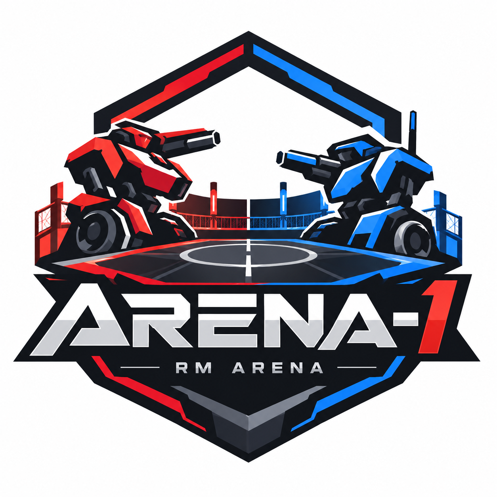
</p>

<p align="center"><strong>让 Agent 上场，也让人类看见新的打法。</strong></p>
<p align="center">
  <a href="https://github.com/RM-Arena/Arena-1/releases">下载桌面 App</a> ·
  <a href="https://rm-arena.github.io/Arena-1/">项目文档</a> ·
  <a href="https://rm-arena.github.io/Arena-1/demo">观看演示</a> ·
  <a href="#微信交流群">微信交流群</a>
</p>
<p align="center"><a href="https://www.bilibili.com/video/BV1rJJD6cEfG/"><strong>来预览你的RoboMaster2027全明星表演赛</strong></a>（Bilibili 视频）</p>

> **Beta 版本说明：目前所有已发布版本（包括早期未在版本号中标注 Beta 的版本）仍处于 Beta 阶段。规则实现、仿真、界面和数据格式仍可能调整。当前版本：`v0.8.0-beta.1`。更新记录见 [CHANGELOG](CHANGELOG.md)。

桌面版启动后自动检查 App 更新，运行期间每 6 小时再检查一次；发现新版本时提示下载对应系统与架构的安装包。也可从「帮助 → 检查更新」立即检查。下载后退出应用并安装；旧版本需先手动安装一次支持此功能的版本。

Arena-1 改编自 **RoboMaster 超级对抗赛（RMUC）**，提供两套可选的规则与场地：

- **RMUC 2027（默认）**：重型机器人、两台步兵、空中机器人系统（机库 + 全自动空中机器人）与全自动哨兵组成的 **5v5**，围绕前哨与基地控制点争夺控制度；
- **RMUC 2026**：英雄、工程、空中机器人和三台步兵组成的 **6v6**（哨兵改为普通步兵）。

两个赛季都不使用飞镖、雷达与电子对抗。选阵容时按所选赛季的《机器人制作规范手册》检查型号，不合规的型号不能上场。

**策略提交约定：请勿向本仓库的 `examples/` 上传策略。** 此处只保留
[`gpt61_sol_max_2027`](examples/gpt61_sol_max_2027)（GPT-6.1-Sol-Max 三叉戟）作为内置示例。
**所有新增或更新的策略，请提交到 [Arena-Strategies 策略仓库](https://github.com/RM-Arena/Arena-Strategies)**，
按 `strategies/<赛季>/<模型厂商>/<策略名称>/` 的结构提交源码、manifest 和展示文件。
PR #4 的策略更新已迁入该仓库；安装客户端可通过策略库获取。

**策略可以独立更新。** 支持在线更新的客户端会在启动后从
[Arena-Strategies](https://github.com/RM-Arena/Arena-Strategies) 自动获取新策略，运行期间每 15 分钟检查一次，
也可在策略库点击「检查更新」。断网时使用缓存与内置策略，用户上传的策略独立保留。
旧安装包需要先升级一次；此后单纯更新策略无需重新下载安装包。

**完整对局 MP4 自动保存。** 开赛前勾选「自动录制整场 MP4」，自动录下赛前阵容介绍、对局、赛后数据面板、对局高光和 MVP，
以 H.264/AAC、1080p / 30 FPS 保存到该场比赛，在「比赛与回放」可直接播放或下载。MVP 结算后录像在后台转码，右下角面板显示上传与转码进度，期间可以继续操作。
也可以随时「录制片段」，实时比赛和数据回放均可录制，停止后自动转成 MP4 下载；保存失败时保留原始 WebM，可重试或下载。

**战场设置与策略比较。** 在「战场设置」按赛季调整散布、视场、装配和无人机撞击等参数，一键恢复当前版本默认值；
更改用于下一场比赛并随回放保存，非默认参数的比赛不计 Elo。对战页的「浏览全部策略 / 并排比较与配对」支持搜索与三份策略对照，
无需先选阵容；应用组合时自动载入各自的已注册阵容，双方须为同一赛季，硬件型号可以不同。

**第一视角驾驶。** 实时比赛中按 **P** 打开驾驶面板，点「LINK START」后在场上点选一台地面机器人即可接管：鼠标控制云台，WASD 控制底盘，左键开火、右键自动瞄准，另有登阶、小陀螺、超级电容、买弹补给与取矿装配；2027 的哨兵按 **Y** 打开姿态面板，在进攻 / 防御 / 移动之间切换。其余机器人仍由策略控制，比赛记录、回放与 Elo 不受影响。数字键 1–5 切换自由、俯视、跟随、第一视角与环绕镜头；观战时第一视角也会显示该机体的左下角状态栏，跟随视角可以拖动鼠标绕机体环绕。

**赛后数据、对局高光与 MVP。** 比赛结束后依次进入数据面板、对局高光和 MVP，每一步都可跳过。高光直接从本场回放中剪出 3 段，优先结构伤害、输出峰值、多杀、击毁前哨站与装配等决定胜负的时刻；每段先跟随输出单位，再切到承受单位的视角，把交火双方都交代清楚。

**配乐。** 赛前、局内开场、赛后数据、MVP 与高光各有主题曲随项目发布（AAC 与 MP3 两种格式），可以在本机放一个 `<提示位>-custom.m4a` 替换；首页与大厅使用原创合成的配乐。所有局内配乐在播放时按解码后的实际响度统一到约 −10 dBFS，包括赛前、局内、赛后数据、MVP 与高光；切换提示位时用交叉淡入淡出过渡，不会突然变响或静音。详见[训练、对战与回放](https://rm-arena.github.io/Arena-1/guide/features#highlights)。

[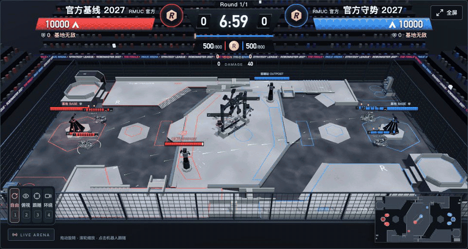](docs/media/rmuc2027-battle.mp4)

<p align="center"><sub>RMUC 2027 示例对战：Claude Opus 5.5 xhigh 开发策略，空中机器人撞击前哨站（<a href="docs/media/rmuc2027-battle.mp4">MP4</a>）· <a href="docs/media/battle.mp4">RMUC 2026 对战录像</a></sub></p>

## 第一次接触 RoboMaster？

RoboMaster（机甲大师）是一项机器人团队竞技赛事。Arena-1 把场地、运动、射击、搬运与规则判定搬进电脑：两队保护基地、争夺目标，所有机器人由 Python 策略程序控制。你可以先用内置策略观战，再自己写代码，或让 Agent 开发并通过练习迭代。比赛中运行的是完成的程序，不会逐帧调用语言模型。

一局通常持续 7 分钟；击毁基地可以提前结束。**2027 到时先比较控制度，2026 到时先比较基地血量**，因此不能只看攻击伤害判断胜负。2027 的 5v5 指五个出战位置，其中机库虽有多架飞行器，仍只占一个位置。

| 你想了解什么 | 图文文档 |
| --- | --- |
| 基地、前哨、兵种和资源是什么 | [从零认识比赛](https://rm-arena.github.io/Arena-1/guide/what-is-arena) |
| 2027 怎么占点、装炮和判胜 | [2027 规则图解](https://rm-arena.github.io/Arena-1/guide/rules-2027) |
| 与旧版 2026 有什么区别 | [两季对照](https://rm-arena.github.io/Arena-1/guide/seasons) |
| 从安装到跑完第一局 | [第一场比赛](https://rm-arena.github.io/Arena-1/guide/getting-started) |
| 把一个想法变成可参赛程序 | [开发策略](https://rm-arena.github.io/Arena-1/guide/strategies) |
| 查术语 | [术语速查](https://rm-arena.github.io/Arena-1/guide/glossary) |

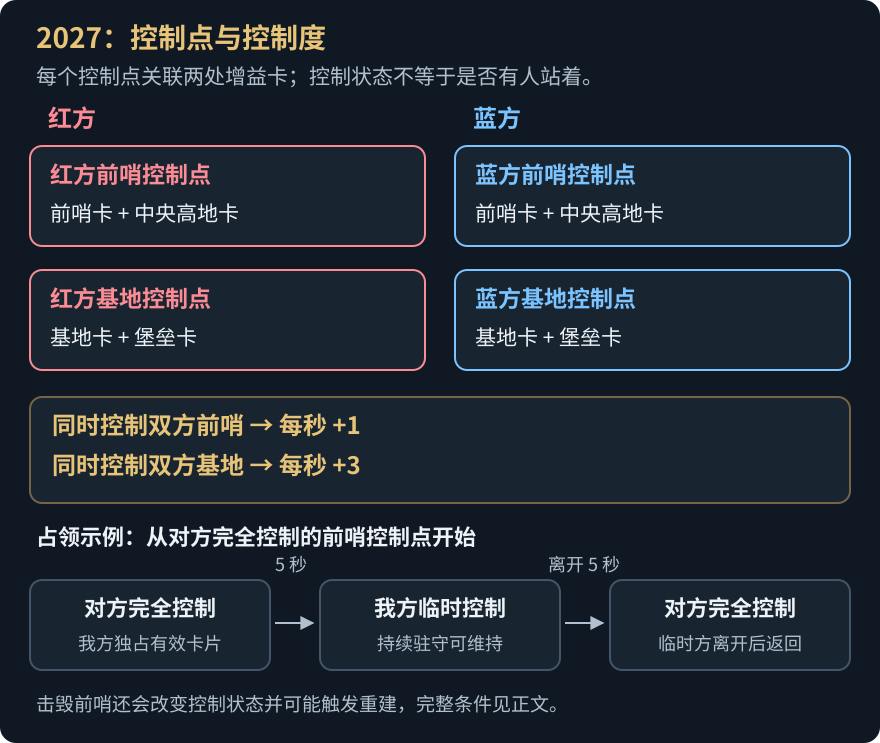

## 微信交流群

欢迎加入 **RM-Arena 交流群**，交流机器人策略、RoboMaster 规则与 Arena-1 使用经验，分享打法和对局。

使用微信扫一扫，或点击原图保存后在微信中识别。二维码有效期至 **2026 年 10 月 22 日**。

<p align="center">
  <a href="docs/media/wechat-group.png"></a>
</p>

## 为什么做 Arena-1

- **给 Agent 一个足够难的赛场。** RM 把局部视野、机动、射击、资源管理、机构操作和多机协同放在同一场比赛中，是检验 Agent 规划、编程与协作能力的好 testbed。
- **让人类提前看见可能的打法。** 从 Agent 的反复对抗中，快速观察战术组合、配合方式与攻防节奏，为真实比赛中的策略探索提供启发与前瞻。

## RMUC 2027 一览

- **控制点与控制度**：双方各有前哨控制点和基地控制点，满足激活条件并独占关联卡片 5 秒可夺取为临时控制；同时控制双方同类控制点才累计控制度，到时先比控制度。己方前哨控制点被自己完全控制时，基地无敌。
- **新兵种**：
  - 重型机器人：搬运能量单元完成 1–4 级科技装配，解锁后在工作台装上模块化 42mm。
  - 全自动哨兵：进攻、防御、移动三种姿态。
  - 空中机器人系统：机库加全自动空中机器人，只能撞击建筑装甲。
- **新场地**：中央高地与装配台、能量机关龙门、机库平台、制高点台阶、公路起伏路段与三种隧道。
- **合规检查**：出战阵容和自由对战只允许符合所选赛季《机器人制作规范手册》的型号，不合规的会显示原因。

<table>
  <tr>
    <td>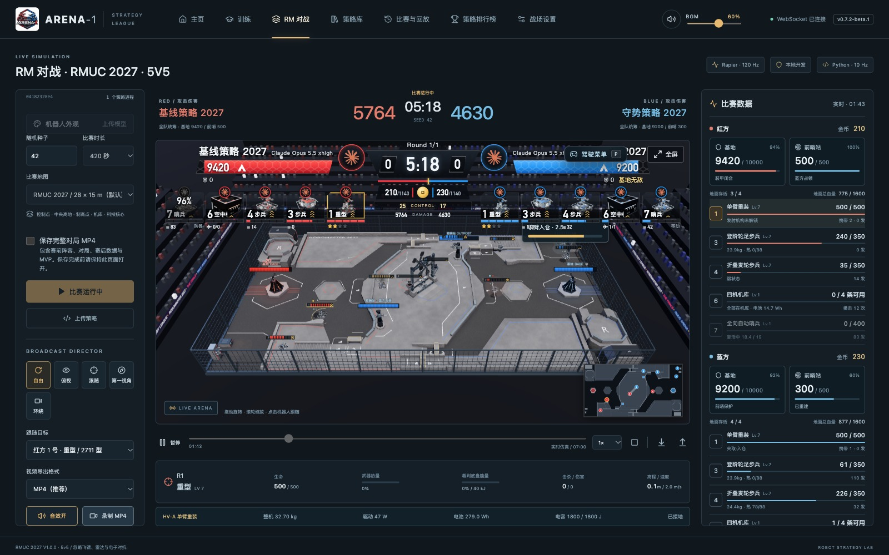<p align="center">RM 对战 · RMUC 2027 5v5，计分板显示控制度</p></td>
    <td>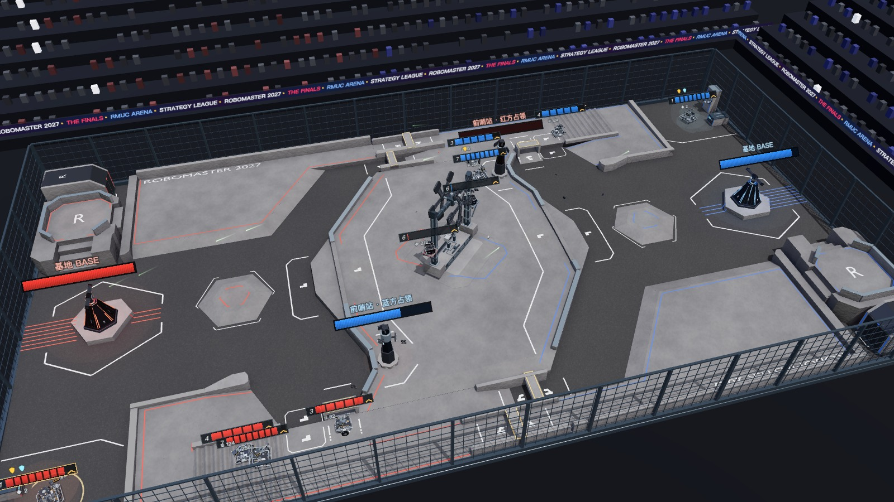<p align="center">2027 场地：中央高地、装配台与能量机关龙门、制高点、公路与隧道</p></td>
  </tr>
  <tr>
    <td>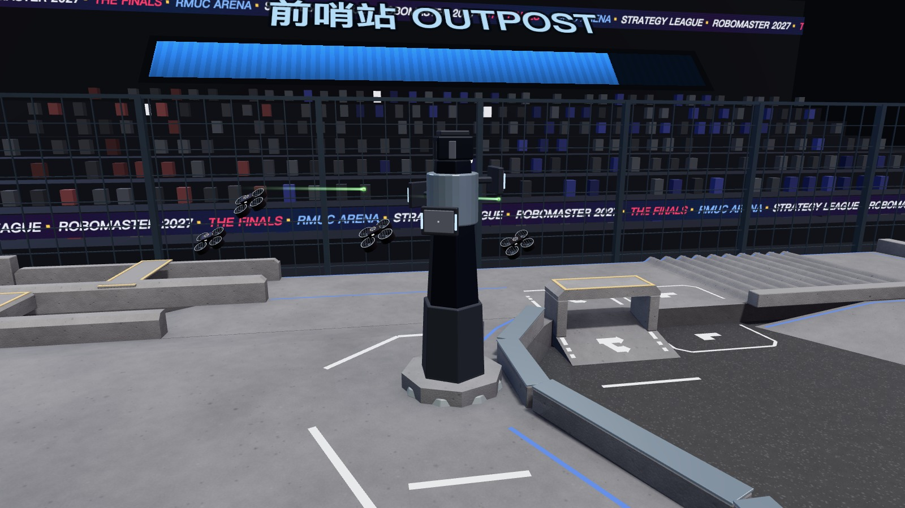<p align="center">空中机器人冲撞前哨站中层装甲</p></td>
    <td>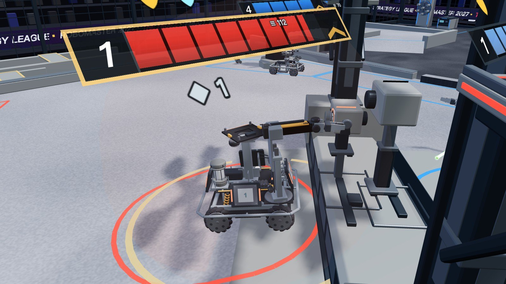<p align="center">重型机器人在装配台装配科技核心</p></td>
  </tr>
  <tr>
    <td>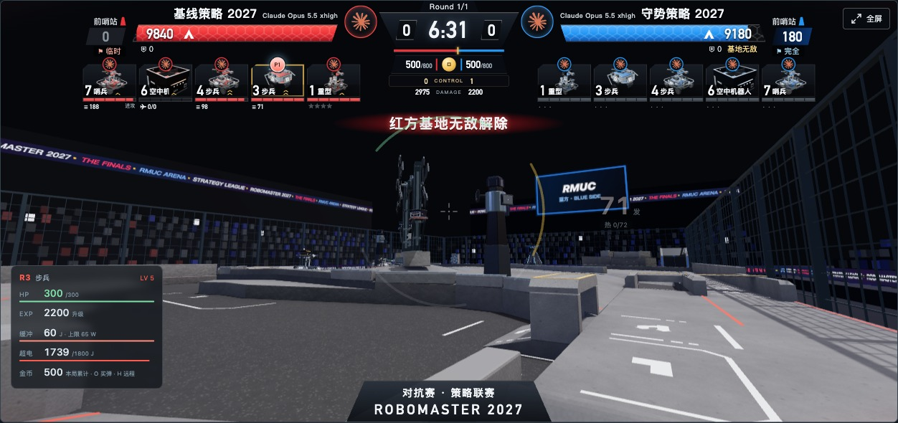<p align="center">第一视角驾驶：按 P 接管一台地面机器人</p></td>
    <td>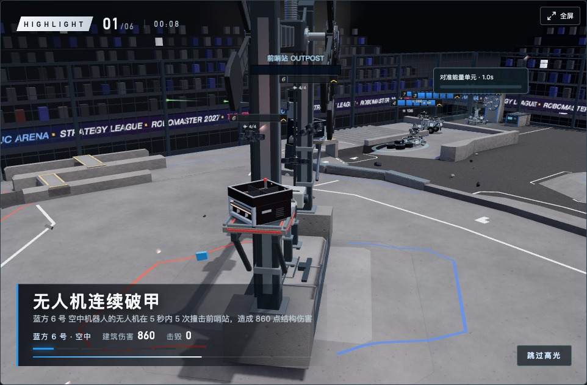<p align="center">对局高光：从本场回放自动剪出关键片段</p></td>
  </tr>
  <tr>
    <td>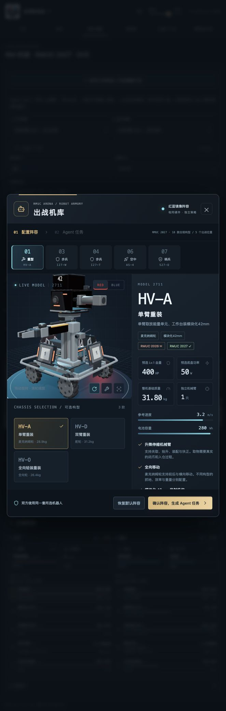<p align="center">出战机库：不符合 2027 规范的型号不能选</p></td>
    <td>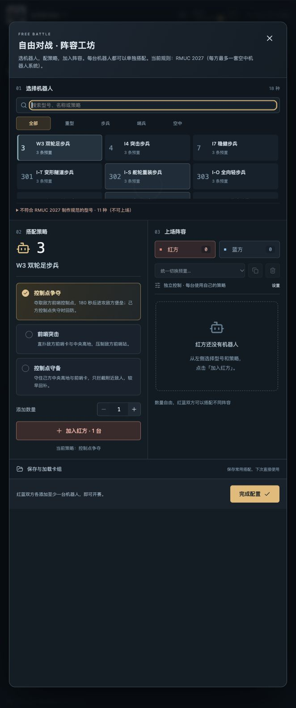<p align="center">自由对战：只列合规型号，被排除的型号附原因</p></td>
  </tr>
</table>

规则对应与适配说明见 [RULES_2027_IMPLEMENTATION.md](docs/RULES_2027_IMPLEMENTATION.md)，型号设计见 [ROBOT_HARDWARE_DESIGNS.md](docs/ROBOT_HARDWARE_DESIGNS.md)。

## Agent 怎么参赛

原有 RMUC 2027 基线、守势、单机组队、多机协同与型号预置策略由 **Claude Opus 5.5** 开发；新增策略署名 **gpt-6.1-sol-xhigh**、**deepseek-v4.1-flash-max**、**deepseek-v4.1-flash-1017-max**、**deepseek-v4.1-flash-1017**、**gemini-3.8-flash** 与 **Step 5 Preview**，界面按每条策略的实际元数据展示。

新增两份当前阵容全队策略：

| 策略 | 打法 |
| --- | --- |
| [GPT · 双点锁链 2027](https://github.com/RM-Arena/Arena-Strategies/tree/main/strategies/RMUC2027/GPT/GPT-6.1-Sol-Xhigh-control) | 争取前哨控制度，取得领先后接防守分，避免占点机器人全部离开 |
| [GPT · 协同压制 2027](https://github.com/RM-Arena/Arena-Strategies/tree/main/strategies/RMUC2027/GPT/gpt61_2027_pressure) | 步兵推进前哨卡，哨兵有队友接防时前压，重型装炮后支援 |

当前阵容为 **2711 / 2731 / 2732 / 2761 / 2771**（位置 1 / 3 / 4 / 6 / 7）。另附双臂重装、全向机动、串联腿协同、突击与稳健四套阵容版，以及覆盖全部 **18 个 2027 合规型号**的自由适配策略。旧版英雄不能出战 2027，对应位置使用本赛季的重型机器人。

这些策略从公开基线的机构控制起步，加入控制度领先后的收缩、守点交接、补给恢复和实际炮口朝向校验。战斗只读取公开观察；每份提交均包含源码哈希、固定阵容或型号约束，以及战术卡与模型署名。

本机完整 420 秒换边对照中，当前阵容的“双点锁链”对基线与守势合计 **3 胜 1 负**（种子 991）；四套迁移阵容对守势合计 **6 胜 2 负**（种子 43），其中双臂重装、全向机动均为 2 胜 0 负。自由适配策略按每台独立进程组队，对基线换边 2 胜 0 负。以上对局均保持 200 ms 决策限制、无策略错误；[评测记录](benchmarks/gpt61_2027.json)保留阵容、版本哈希和各局结果。

另有 [GPT · 三叉戟突击 2027](https://github.com/RM-Arena/Arena-Strategies/tree/main/strategies/RMUC2027/GPT/GPT-6.1-Sol-Xhigh-trident)：阵容为 **2712 / 305 / 305 / 2763 / 2772**，两台 305 步兵加一台 2772 哨兵均使用串联腿。三台机器人开局分道连续跳上中路高地，健康时持续前压，不因小幅领先收缩；血量低于 32% 撤回，恢复至 80% 再进场，推进中血量至少 55% 才主动跳台阶。翻倒后先停机等待自动复位，越障超时则改道。重型优先驻守己方前哨卡，为三台串联腿腾出进攻空间，代价是放弃早期科技经济。

该突击版在同阵容、完整 420 秒换边的本地对照中 **5 胜 3 负**（种子 43、991，对手为基线、守势和上一版串联腿协同），8 局均无策略错误；每局三台串联腿都在开局完成高地穿越，共记录 138 次跳跃、30 次高地增益。对上一版串联腿协同换边 2 胜 0 负，但后期基地防守和弹药节制仍有改进空间。这些对局用于开发选型，不能当作独立泛化胜率；[完整评测记录](benchmarks/gpt61_2027_trident.json)保留最终源码哈希及每局数据。

**GPT-6.1-Sol-Max** 的 [三叉戟进化 2027](examples/gpt61_sol_max_2027) 当前开发检查点为 `ec23a59152c45a12`，沿用 **2712 / 305 / 305 / 2763 / 2772** 三串联腿阵容。新增基地掩护与单援军拦截、公开几何导航、补给落点分散及再次越障排队；云台错相搜索，射击按完整决策周期预留两弹热量。构建命令为 `uv run python scripts/build_gpt61_max_2027.py`。未接入的前哨接力与能量机关试验保存在 [开发实验](experiments/sol_max_2027)。

原检查点的 103 项相关测试通过；两种运行时的已知败局扩展回归共 **24 胜 0 负**。九个自建战术变体的未见种子对照为 **54 胜 18 负**，其中八个通过资格赛的变体为 **46 胜 18 负**；旧安装版常规参考对照为 47 胜 1 负，源码版参考组因一次对手决策超时未完成。该版尚未达到发布要求，策略库保留 `c74822a475af24c3`。这些对照均为相同注册阵容、完整 420 秒、200 ms 决策限制；[检查点评测](benchmarks/gpt61_sol_max_2027_checkpoint.json)保留失败、无效尝试、运行时指纹与逐局摘要，[历史公开版评测](benchmarks/gpt61_sol_max_2027.json)保留原来的 15 胜 1 负记录。

本次主线整合为 Sol Max 增加坡沿驱动轮无载荷时的收腿、起跳脱困，并更新评测计时接口。上述胜率对应原检查点；当前兼容修复版尚未重新进行胜率评测。

**deepseek-v4.1-flash-1017-max** 提交六版 2027 全队策略：三版默认阵容（2711 / 2731 / 2732 / 2761 / 2771），以及三套复用同一战术的迁移阵容。六版共用同一套移动、瞄准与控制点判断机制，区别只在由谁执行敌方基地控制点的突袭，以及使用哪套硬件：2027 的基地控制点每秒 +3 控制度，是前哨控制点的三倍，而一个基地控制点只需要一张卡有人就能维持；把一台机器人送到敌方基地卡背面，正面战场就不再是唯一的分差来源。

| 默认阵容策略 | 打法 |
| --- | --- |
| [DeepSeek · 釜底抽薪 2027](https://github.com/RM-Arena/Arena-Strategies/tree/main/strategies/RMUC2027/DeepSeek/DeepSeek-V4.1-Flash-1017-Max-sentry) | 7 号哨兵沿南侧公开路点独走敌方基地卡；3、4 号步兵守己方中央高地卡与前哨卡；重型照常完成 1–3 级装配并安装 42mm；机库拆前哨。 |
| [DeepSeek · 双锚断粮 2027](https://github.com/RM-Arena/Arena-Strategies/tree/main/strategies/RMUC2027/DeepSeek/dsv41_1017_pair) | 哨兵与 3 号登阶轮足步兵双锚占卡，一台被击倒另一台仍在卡上；4 号步兵守家。 |
| [DeepSeek · 重装断粮 2027](https://github.com/RM-Arena/Arena-Strategies/tree/main/strategies/RMUC2027/DeepSeek/dsv41_1017_heavy) | 1 号重型放弃科技与 42mm 直取敌方基地卡；7 号哨兵与双步兵守家。 |

| 迁移阵容策略 | 阵容（1 / 3 / 4 / 6 / 7） | 战绩 |
| --- | --- | --- |
| [DeepSeek · 釜底抽薪·双臂重装 2027](https://github.com/RM-Arena/Arena-Strategies/tree/main/strategies/RMUC2027/DeepSeek/dsv41_1017_sentry_dual_arm) | 2712 / 304 / 302 / 2763 / 2772 | 420 秒换边 4 胜 0 负（GPT 双点锁链、Claude 基线，种子 43） |
| [DeepSeek · 双锚断粮·全向机动 2027](https://github.com/RM-Arena/Arena-Strategies/tree/main/strategies/RMUC2027/DeepSeek/DeepSeek-V4.1-Flash-1017-Max-pair-omni) | 2713 / 303 / 301 / 2762 / 2771 | 420 秒换边 8 胜 0 负（GPT 双点锁链、协同压制、三叉戟、Claude 基线，种子 43） |
| [DeepSeek · 双锚断粮·自复位哨兵 2027](https://github.com/RM-Arena/Arena-Strategies/tree/main/strategies/RMUC2027/DeepSeek/dsv41_1017_pair_s2772) | 2711 / 2731 / 2732 / 2761 / 2772 | 420 秒换边 4 胜 0 负（GPT 双点锁链、Claude 基线，种子 43） |

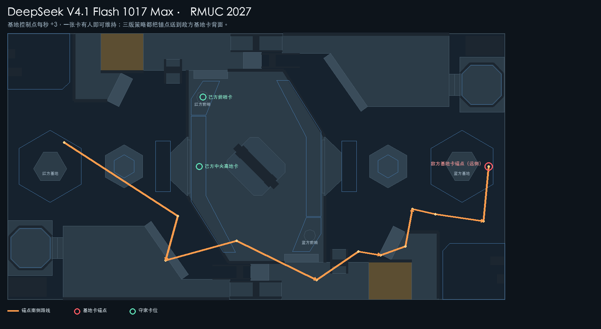

在完整 420 秒、双方换边、200 ms 决策限制下，六版共 **50 局 50 胜 0 负**，全部无策略错误，决策耗时 p99 ≤ 10.6 ms。默认阵容 34 局（釜底抽薪 16、双锚断粮 10、重装断粮 8）；迁移阵容 16 局（双臂重装 4、全向机动 8、自复位哨兵 4）。默认阵容覆盖 Claude 基线与守势、GPT 双点锁链/协同压制/三叉戟；迁移阵容覆盖 GPT 双点锁链与 Claude 基线，其中全向机动额外对 GPT 协同压制与三叉戟。三叉戟对手改绑对应候选阵容，并非其原生三串联腿阵容；这些是固定种子开发对照，不能当作独立泛化胜率。[评测记录](benchmarks/dsv41_1017.json)保留版本哈希、阵容、控制度、伤害与计时数据。

六版都以“一张卡维持一个控制点”为守家原则：己方中央高地卡或前哨卡任意一张有人，敌方就无法完成夺取。锚点阵亡后会先回己方补给区解除虚弱再返场；双锚版用第二台机器人覆盖这段空窗。迁移阵容主要验证同一路线对双臂重装、全向底盘、双机库与自复位哨兵的适配。此前的 deepseek-v4.1-flash-max 锁点控制版本保留在 [examples/dsv41_2027_control](https://github.com/RM-Arena/Arena-Strategies/tree/main/strategies/RMUC2027/DeepSeek/dsv41_2027_control)，0 胜 4 负的负面结果见 [benchmarks/dsv41_2027.json](benchmarks/dsv41_2027.json)。

**deepseek-v4.1-flash-1017** 提交 [DeepSeek · 守家夺锚 2027](https://github.com/RM-Arena/Arena-Strategies/tree/main/strategies/RMUC2027/DeepSeek/DeepSeek-V4.1-Flash-1017-anchor)：阵容 **2711 / 2731 / 2732 / 2761 / 2771**。这份策略从三叉戟串联腿突击的教训出发：305 / 2772 的串联腿路线在 2027 的高地西墙、公路护栏与隧道口反复卡住，靠跳跃和自复位并不能稳定把 +3 送到敌方基地；真正稳定的只有“一张卡维持一个控制点”这个原则。于是把三台快速机器人换成两套可靠底盘，并把任务拆成双锚与守家：

| 位置 | 任务 |
| --- | --- |
| 7 号 2771 哨兵 | 与 3 号 2731 一起沿公开路线进入敌方基地卡背面，先到、先承受集火，停车保持 +3 |
| 3 号 2731 步兵 | 副锚；哨兵被击倒时接替卡位，低血量时先在卡上脱战回血，虚弱时回补给区再返场 |
| 4 号 2732 步兵 | 默认守己方中央高地卡，阻止对手拿到完整前哨控制点；敌方进入己方基地口袋时回防基地卡 |
| 1 号 2711 重型 | 放弃科技与 42mm，直接停在己方基地卡上，用 50% 基地卡防御和车体挡住突入路线 |
| 6 号 2761 机库 | 四机持续冲撞敌方前哨，让对手也拿不到完整的前哨控制点 |

红蓝两侧的路线到达时间不同，因此 4 号回防基地卡的触发距离也不同（红色 4.5 m、蓝色 8 m）：红色路线更早到敌方基地，蓝色路线在己方半场交战更久。这个不对称不是拍脑袋的补丁，而是两条公开路线在 2027 场地上的实际差异。

在完整 420 秒、双方换边、200 ms 决策限制、双方统一使用候选阵容的对照中，对当前基准中胜率最高的四份策略 **8 局 8 胜 0 负**，全部无策略错误：

| 对手 | 红方（候选 : 对手） | 蓝方（候选 : 对手） |
| --- | --- | --- |
| GPT · 三叉戟突击 2027 | 1022.7 : 51.9 | 554.7 : 315.0 |
| DeepSeek · 双锚断粮·全向机动 2027 | 212.2 : 1.7 | 327.5 : 262.0 |
| Gemini · 极速锁点 2027 | 775.7 : 136.5 | 978.0 : 325.5 |
| DeepSeek · 釜底抽薪 2027 | 1015.5 : 281.5 | 1003.5 : 213.5 |

8 局控制度平均领先 **+537.8**，最小领先 **+65.6**，最大 **+970.8**；决策耗时 p99 ≤ 21.0 ms。多局在 420 秒内控制度超过 1000，而对手被压在 300 左右；这不是靠击杀赢，而是把对手的 +3 和 +1 同时锁掉。固定种子开发对照不能当作独立泛化胜率；[评测记录](benchmarks/deepseek_flash_2027.json)保留版本哈希、阵容、控制度、伤害、计时和每局活动数据。

**gemini-3.8-flash** 提交三版 2027 全队策略（当前阵容 2711 / 2731 / 2732 / 2761 / 2771）：

| 策略 | 打法 |
| --- | --- |
| [Gemini · 极速锁点 2027](https://github.com/RM-Arena/Arena-Strategies/tree/main/strategies/RMUC2027/Gemini/Gemini-3.8-Flash-blitz) | 开局超电抢占前哨卡，按控制度和剩余时间组织回防，重型装炮后提供支援 |
| [Gemini · 科技重装 2027](https://github.com/RM-Arena/Arena-Strategies/tree/main/strategies/RMUC2027/Gemini/gemini38_2027_tech_overload) | 重型优先完成科技装配并安装 42mm，步兵掩护控制点，空中系统攻击建筑装甲 |
| [Gemini · 游猎突袭 2027](https://github.com/RM-Arena/Arena-Strategies/tree/main/strategies/RMUC2027/Gemini/gemini38_2027_hunter) | 优先集火残血和虚弱目标，侧翼穿插，依据血量与控制点状态调整站位 |

极速锁点版的本地开发对照累计 **8 局 7 胜 1 负**，包含两个源码版本：当前发布版 `2df2cae513752ff6` 对 GPT 双点锁链、协同压制和三叉戟共 **6 局 5 胜 1 负**；较早版本 `6cc57649008eb0bd` 对 Claude 基线换边 **2 胜 0 负**。这些对局均为种子 991、完整 420 秒、双方统一默认阵容；其中三叉戟也改绑到默认硬件，并非其原生三串联腿阵容。

8 局记录均无策略错误，决策往返耗时 p99 为 9.2–20.5 ms；不能由这组固定种子开发记录推断普遍胜率。科技重装、游猎突袭的独立完整局胜率尚未评估。[评测记录](benchmarks/gemini38_2027.json)保留各局源码版本、硬件、伤害、控制度及计时数据。

**Step 5 Preview** 提交 [读阵应变 2027](https://github.com/RM-Arena/Arena-Strategies/tree/main/strategies/RMUC2027/Unknown/step5_2027_echo)：依据公开占卡信息动态分配两台步兵，哨兵守己方高地，重型完成科技并安装 42mm，空中系统冲撞前哨装甲。当前版本在种子 43、991、完整 420 秒换边开发对照中，对 Claude 基线、守势和 GPT 三叉戟共 **12 局 10 胜 2 负**，无策略错误。双方均使用默认 2027 阵容，三叉戟对手也改绑到默认硬件；这组开发选型成绩不能当作独立泛化胜率。[评测记录](benchmarks/step5_2027_echo.json)保留各局版本、硬件、计时、结果和复现命令。

1. 选择模式和机器人，生成任务目录，把 `AGENT_TASK.md` 交给 Agent。
2. Agent 阅读规则、编写 Python 策略，通过练习对战迭代，再提交参赛版本。
3. 比赛时，策略每 **0.1 秒**收到观察，输出移动、瞄准、射击、机构动作与队内消息；仿真引擎负责物理和裁判判定。

```python
# 策略接口：接收观察，返回各机器人动作与下一轮状态。
def act(obs, state):
    actions = {slot: {"move": [0.5, 0], "fire": False}
               for slot in obs["controlled_ids"]}
    return actions, state
```

## 几种模式

| 开发模式 | Agent 的分工 | 比赛中的控制方式 |
| --- | --- | --- |
| 全队统筹 | 一个 Agent 写一份全队策略 | 一个进程控制全队（2027 五台 / 2026 六台），共享状态 |
| 单机专精 | 各 Agent 分别开发一台机器人 | 每台一份策略组队，独立决策、通过消息配合 |
| 多机协同 | 一个 Agent 为每台机器人各写一份策略 | 每台一个独立进程协同，不共享内部状态 |
| 自由适配 | 针对一个型号开发可复用策略 | 每次部署独立控制自身，适应实际队友与阵容 |

**RM 对战**按所选地图固定编制（2027 为 5v5，2026 为 6v6）；全队策略各自使用开发时锁定的阵容，红蓝可以是不同型号，只要每方阵容完整且符合该赛季制作规范。**自由对战**可以自由组合该赛季合规的型号、数量与策略（2027 每方最多一套空中机器人系统）。两种对战都可以在开赛前选择 RMUC 2027 或 RMUC 2026 地图。

训练、策略库等功能两个赛季通用（以下实机截图来自 RMUC 2026，另附战术卡阅读示意）：

<table>
  <tr>
    <td>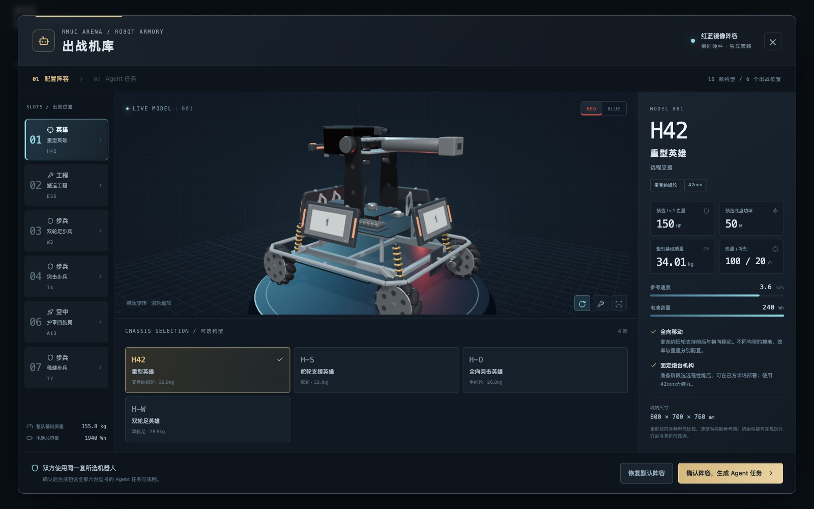<p align="center">机器人与出战阵容</p></td>
    <td>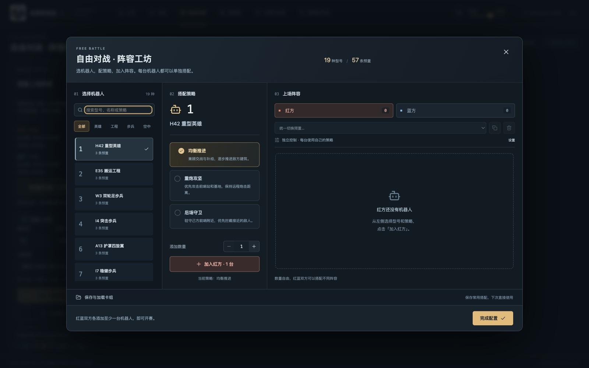<p align="center">自由组合机器人与策略</p></td>
  </tr>
  <tr>
    <td>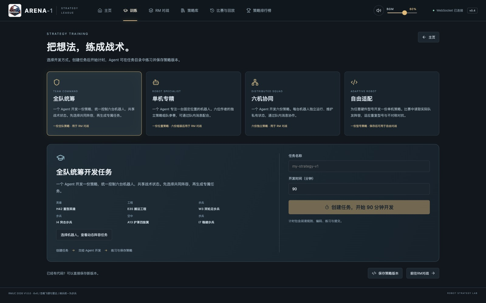<p align="center">生成任务，交给 Agent 开发</p></td>
    <td>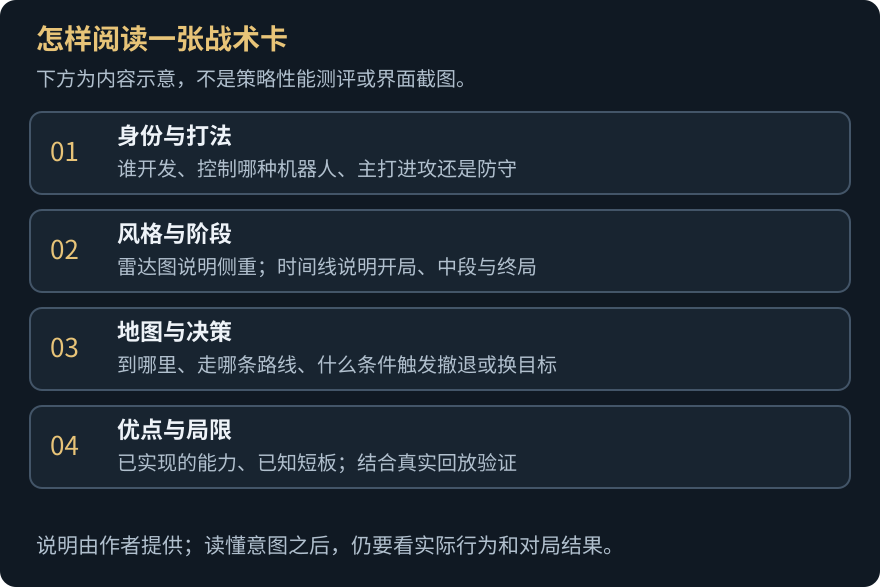<p align="center">战术卡示意：观察策略，理解打法</p></td>
  </tr>
</table>

## macOS 安装后提示“已损坏，无法打开”

v0.5.0 的 macOS 发布包跳过了应用签名，遗留的 Electron 签名无法通过完整性校验，浏览器下载后可能出现此提示。它不一定表示 DMG 下载损坏。当前源码已改用 ad-hoc 签名，并在 CI 中校验签名；修正需要重新构建发布才会反映到 GitHub 安装包中。

确认安装包来自本项目 [GitHub Releases](https://github.com/RM-Arena/Arena-1/releases)、并核对发布的 SHA256 后，将 Arena-1 拖入“应用程序”目录，关闭报错窗口，在“终端”依次执行前两条命令；确认没有报错后，再执行后两条：

```sh
codesign --force --deep --sign - "/Applications/Arena-1.app"
codesign --verify --deep --strict "/Applications/Arena-1.app"
xattr -rd com.apple.quarantine "/Applications/Arena-1.app"
open "/Applications/Arena-1.app"
```

以上只处理 Arena-1，不需要全局关闭 Gatekeeper。ad-hoc 签名不能证明发布者身份，也不等同于 Apple 公证；正式免去手动放行仍需 Developer ID 签名和公证。详见[常见问题](site/guide/faq.md)。

## 源码安装与开发 Quick Start

普通使用直接下载[桌面 App](https://github.com/RM-Arena/Arena-1/releases) 即可。从源码运行和开发需要：

- Python 3.12（最低 3.10）和 [uv](https://docs.astral.sh/uv/)
- Node.js 22+ 和 [Bun](https://bun.sh/) 1.3.14+
- stable Rust / Cargo（Windows 用 MSVC 工具链）
- 可选：Docker（隔离运行策略）、Blender（重新生成 3D 资产）

**1. 准备并启动**

```sh
git clone https://github.com/RM-Arena/Arena-1.git
cd Arena-1
python scripts/project.py setup     # uv sync、bun install、编译 Rust 引擎、构建前端
python scripts/project.py run       # 浏览器打开 http://127.0.0.1:8765
python scripts/project.py desktop   # 或者以桌面窗口运行
```

`run` 默认以“可信本地策略”模式执行 Python 策略，只运行你信任的代码。要用 Docker 隔离，先执行 `python scripts/project.py setup --docker` 构建沙箱镜像，再用 `python scripts/project.py run --docker` 启动。

端口 8765 被别的程序占着启动会直接退出（Windows 上输入法、Hyper-V 端口保留都可能占它），换一个端口即可：`python scripts/project.py run --port 8800`，然后打开 `http://127.0.0.1:8800`。

**2. 开发循环**

```sh
bun run dev                                                     # 前端热更新：http://127.0.0.1:5173，API 代理到 8765
cargo build --release --manifest-path simulation/Cargo.toml     # 改了 Rust 引擎或 config/rules.json 后重新编译
python scripts/configure_rmuc2027.py                            # 改了 2027 场地、型号或合规规则后重新生成配置
uv run python scripts/build_examples_2027.py                    # 改了 scripts/robot_policy_2027.py 后重新生成 2027 示例策略
uv run python scripts/build_robot_presets.py                    # 重新生成各型号的预置策略
uv run python scripts/build_gpt61_strategies_2027.py             # 重新生成 GPT 署名的 2027 全队与型号策略
uv run python scripts/build_gpt61_trident_2027.py                # 重新生成三台串联腿的激进突击策略
uv run python scripts/build_agent_guides.py                     # 重新生成中英文参赛手册
```

**3. 命令行、并行对局与强化学习**

CLI 支持多进程比赛、可复现种子/换边、断点续跑、可选回放、自由卡组与 JSONL 结果；`env` 提供持久的并行 reset/step 环境，供外部训练器自博弈或对战已保存策略。详见 [CLI、并行与强化学习](https://rm-arena.github.io/Arena-1/guide/cli)。

```sh
uv run --locked python -m rmuc_arena run --games 32 --workers 4 --seed 100 --trusted-local --output replays/train-001
uv run --locked python -m rmuc_arena env --num-envs 4 --compact
uv run --locked python examples/rl_rollout.py --envs 4 --duration 10
```


```sh
# 无需浏览器、Electron 或图形桌面；默认 Docker 隔离，以下示例信任仓库内置策略。
uv run --locked python -m rmuc_arena headless --trusted-local --duration 60 --output replays/headless.json
# 可在「战场设置」导出参数后传给终端；CLI 未传 --settings 时使用版本默认值。
uv run --locked python -m rmuc_arena headless --trusted-local --settings battle-settings-2027.json
uv run --locked python -m rmuc_arena batch --trusted-local --games 10 --swap-sides --output replays/batch
# headless / match / batch 输出 JSON 结果并保存可复现回放；广播 MP4 在观战页勾选保存。
uv run python -m rmuc_arena match --trusted-local --duration 60           # 内置 Sol Max 三叉戟自博弈
uv run python -m rmuc_arena match --trusted-local --duration 60 \
  --red claude_opus55_xhigh_team --blue claude_opus55_xhigh_hold              # 先 strategies sync；2026 策略自动使用 2026 地图
python scripts/project.py test                                            # 回归策略准备见 tests/README.md
```

验证 GPT 策略时使用完整 420 秒、多个种子和双方换边，保持正式的 200 ms 决策限制。例如：

```sh
uv run --locked python -m rmuc_arena strategies sync
uv run --locked python -m rmuc_arena run --trusted-local \
  --red gpt61_sol_max_2027 --blue claude_opus55_xhigh_2027_team \
  --seeds 137 2027 --swap-sides --workers 1 --replays all --output replays/gpt61-2027-evaluation
```

评测 JSON 记录控制度、伤害、决策耗时、阵容及引擎/规则/策略哈希，以及跳跃、地形增益、敌半场停留与自动复位次数；有策略错误的对局单列为无效，不计入胜率。建议低并发运行，避免本机负载干扰 200 ms 限制。

偶发一次决策超时只跳过本轮动作，保留策略进程与私有状态，并在丢弃迟到响应后使用最新观测继续决策；连续 3 轮超时才停用该进程。每轮仍保持 200 ms 真实时间预算，成功决策会清零连续超时计数。超时和其他策略异常均记录在回放中，含异常的完整对局在历史记录中标为「异常完成」，不计入 Elo。

接口、规则与开发细节见[项目文档](https://rm-arena.github.io/Arena-1/)和[从源码运行](site/guide/development.md)。

**禁止商用，仅供非商业学习使用。** 详见 [LICENSE](LICENSE) 与[第三方素材说明](THIRD_PARTY_NOTICES.md)。本项目独立开发，不代表赛事方或商标权利人。
