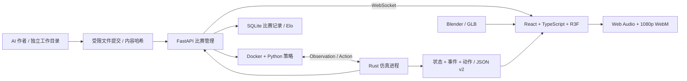

# RMUC Arena / Strategy League

AI 编写 Python 策略，控制双方各 7 台机器人对战。比赛由 Rust 计算，策略在独立 Docker 容器内执行，浏览器通过 WebSocket 实时接收状态，用 React Three Fiber 显示 Blender 导出的 3D 场景。

v0.2 已采用 Rust + Python/FastAPI + React/TypeScript/Vite 的架构。它是 RMUC 风格的策略游戏：机器人使用带加速度的运动学控制、圆形底盘碰撞与地形高度，弹丸具有重力和三维扫掠命中。当前使用自定义 Rust 物理逻辑；Rapier 和 Protobuf 尚未接入。

## 启动

需要 Python 3.10+、uv、Node.js 20.19+ 或 22.12+、Rust/Cargo、运行中的 Docker。运行已经导出的模型无需安装 Blender；修改资产时需要 Blender。

```bash
./scripts/setup.sh
./scripts/run.sh
```

也可以手动执行：

```bash
uv sync --locked
npm ci
cargo build --release --manifest-path simulation/Cargo.toml
docker build -t rmuc-arena-policy:0.2 -f sandbox/Dockerfile .
npm run build
.venv/bin/python -m rmuc_arena serve
```

打开 <http://127.0.0.1:8765>。默认通过 Docker 执行策略；服务仅绑定本机。点击开始对战后，双方策略容器初始化，Rust 以 20 Hz 更新比赛，Python 以 10 Hz 决策，观战画面独立插值渲染。

前端开发可运行 `npm run dev`，打开 <http://127.0.0.1:5173>；Vite 将 `/api` 和 WebSocket 代理到 8765。FastAPI 文档位于 <http://127.0.0.1:8765/docs>。

## 架构



| 模块 | 实现 |
| --- | --- |
| 仿真核心 | `simulation/src/lib.rs`；规则、移动、碰撞、弹道、命中、伤害、据点、经济、胜负 |
| Rust 接口 | `simulation/src/main.rs` 提供持久 JSON-lines 进程；Python `engine.py` 只负责传输 |
| Agent SDK | `rmuc_arena/sdk.py`；Observation / Action / RobotState 类型提示与导航、弹道辅助 |
| Agent Runtime | `runner.py`、`worker.py`、`sandbox/Dockerfile`；持久策略进程、状态、截止时间、权限限制 |
| 后端 | `server.py` / FastAPI；提交、开赛、暂停、停止、速度控制、WebSocket、回放下载 |
| 数据记录 | `store.py` / SQLite；比赛版本、结果、回放路径、策略版本 Elo，重启后仍保留 |
| 前端 | `frontend/src` / React、TypeScript、Vite；观战、策略提交、排行榜、比赛历史、回放播放器 |
| 渲染 | React Three Fiber + Three.js；GLB、炮塔与炮管动画、车轮、阴影、粒子、观战镜头、小地图 |
| 资产 | `assets/blender/*.blend` 与源程序；五种机器人、基地、两张工业地图，共 8 个 GLB |
| 回放 | Rust 产生权威状态；保存每步动作、完整状态、事件、规则及引擎指纹；CLI 调 Rust 逐帧复算 |

## 控制模式

每队可独立选择以下模式，支持 1 对 1、1 对 7、7 对 7 个策略进程：

- **全队模式**：一个策略控制己方 7 台机器人，己方视野合并，可以集中规划战术。
- **分机器人模式**：7 个独立策略容器，各控制一个槽位，仅收到自身视野内的敌人；能看到全部队友的公开状态，不能读取队友代码或内部状态。没有策略间消息通道。

观战者可以看到整个战场。观战数据与回放不提供给参赛策略；敌方弹药、冷却、能量、技能状态和内部策略状态不会进入策略观察。

示例策略：`rush` 与 `bastion` 保留兼容；`mixed-squad` 展示 7 个独立进程；`vanguard` 展示兵种分工、热量管理、提前量和弹道俯仰。

## 把任务交给 AI

只给每个作者自己的工作目录。`AGENT_TASK.md` 说明任务、槽位、权限和 API；`sdk.py` 与 `arena.json` 是只读参考；只允许修改 `strategy.py`。

```bash
.venv/bin/python -m rmuc_arena new-agent workspaces/v2-red-ai --mode team
# 让一个 AI 编辑 workspaces/v2-red-ai/strategy.py
.venv/bin/python -m rmuc_arena submit workspaces/v2-red-ai submissions/red-v2

.venv/bin/python -m rmuc_arena new-agent workspaces/v2-blue-ai --mode team
# 让另一个 AI 编辑 workspaces/v2-blue-ai/strategy.py
.venv/bin/python -m rmuc_arena submit workspaces/v2-blue-ai submissions/blue-v2
```

分机器人组队：

```bash
for i in 1 2 3 4 5 6 7; do
  .venv/bin/python -m rmuc_arena new-agent "workspaces/v2-red-r$i" --mode robot --robot "$i"
done
# 分别交给七个 AI，每个 AI 只拿到对应目录。
for i in 1 2 3 4 5 6 7; do
  .venv/bin/python -m rmuc_arena submit "workspaces/v2-red-r$i" "submissions/red-r$i-v2"
done
.venv/bin/python -m rmuc_arena assemble submissions/red-squad-v2 \
  submissions/red-r1-v2 submissions/red-r2-v2 submissions/red-r3-v2 \
  submissions/red-r4-v2 submissions/red-r5-v2 submissions/red-r6-v2 submissions/red-r7-v2
```

刷新页面后新版本会出现在选择框。也可以在观战页「提交策略新版本」窗口中粘贴全队代码，或分别粘贴 7 份机器人代码。后端只接受策略源文件，检查语法与大小，生成不可覆盖的带哈希版本。

`new-agent` 在宿主 `.arena_host/workspaces.json` 保存受保护文件哈希，CLI 提交拒绝 SDK 修改、新增文件、软链接和代码变更。编写阶段的实际工具权限需要在 AI 平台中设置：限制到自己的目录和 `strategy.py`。宿主登记文件、其他作者目录和引擎源码不交给作者。

现有 v1 提交和工作目录保留；新增 v2 工作目录包含新版 SDK。旧提交的基础动作仍兼容。

## Python SDK

```python
from sdk import Observation, Action, action, nearest_enemy, aim_at, aim_pitch, intercept, navigate

def act(obs: Observation, state):
    commands: dict[str, Action] = {}
    for robot in obs["robots"]:
        slot = str(robot["slot"])
        if slot not in obs["controlled_ids"] or not robot["alive"]:
            continue
        target = nearest_enemy(robot, obs)
        if target:
            target = intercept(robot, target)
        commands[slot] = action(
            move=navigate(robot, (20, 12), obs["arena"]),
            aim=aim_at(robot, target) if target else None,
            pitch=aim_pitch(robot, target) if target else 0.04,
            fire=target is not None and robot["heat"] < 85,
            skill=robot["hp"] < robot["max_hp"] * 0.5,
            upgrade="damage",
        )
    return commands, {"ticks": (state or {}).get("ticks", 0) + 1}
```

观察包括 `seed`、20 Hz 的 `tick`、`time`、物理 `dt=0.05`、`policy_dt=0.1`、己方机器人、可见敌人、地图、基地、据点、队伍资源、可见弹丸与公开兵种规格。

坐标 `x/y` 是水平平面，`z` 为高程，单位米；`+x` 朝蓝方基地，`+y` 朝地图南侧。机器人有速度、血量、弹药、炮塔角度、热量、能量、冷却和升级状态。

| 动作字段 | 行为 |
| --- | --- |
| `move` | 世界坐标移动意图 `[vx, vy]`；向量长度限制为 1，实际速度受加速度、地形、技能影响 |
| `aim` | 炮塔偏航，弧度；0 朝 +x；`None` 保持方向；炮塔有限转速 |
| `pitch` | 炮管俯仰，范围 [-0.3, 0.5] 弧度；用于高台和重力弹道 |
| `fire` | 布尔值；有弹药、冷却完成且未过热时发射 |
| `skill` | 布尔值；消耗能量，开启护盾或工程修复；侦察同时获得短暂冲刺 |
| `upgrade` | `damage`、`armor`、`mobility` 分支；队伍有资源时升级，未指定默认火力 |

每个策略进程在一场比赛中持续运行。`state` 是每份策略独立的 JSON 数据，最多 32 KiB。一次决策默认墙钟上限 200 ms，输出最多 16 KiB，每个机器人动作最多 1 KiB，只接受文档字段；代码最多 64 KiB。Docker 初始化上限 20 秒。

未授权槽位、异常、超时、协议错误会停用对应策略并记录诊断；之后机器人不再收到新动作，比赛继续。动作字段的非法数字与类型由 Rust 处理为安全动作，移动意图被截断。模拟器不执行策略发来的规则修改。

## 隔离与确定性

默认每个策略一个 Docker 容器：非 root、只读根目录、只挂载自己的源码、无网络、删除 capabilities、禁止提权，限制 256 MiB、0.5 CPU 和 1 个进程。不能创建额外线程或子进程。SDK 由镜像提供，容器无法访问其他策略文件、宿主比赛服务和 Rust 进程。

只对可信开发代码使用 `--trusted-local`；Docker 不可用时正常模式报错，不会自动降级。不要给策略容器挂载 Docker socket。

Rust 固定步长与固定 RNG 对相同初始条件、同一平台和引擎构建、相同动作序列产生一致结果。确定性策略使用固定随机种子，不读取外部时钟。任意 Python 程序的确定性与墙钟超时不受引擎保证；机器负载可能影响策略截止时间。

回放包含规则配置哈希和 Rust 源码构建哈希。规则变动需重新构建 Rust；Python 启动时检查二进制内的规则指纹，避免配置与引擎不一致。逐帧验证要求匹配的引擎构建；JSON 数值 `0` 与 `0.0` 按数值比较。

## 比赛与物理规则

详细数值在 `config/rules.json`：5 种兵种，英雄、工程、3 台步兵、哨兵、侦察。

- 40×24 米地图，基地 1800 HP；摧毁基地或消灭全部敌人立即获胜，双败则平局。
- 超时依次比较分数、基地 HP、机器人总剩余 HP。
- 移动有加速度与底盘转向，机器人之间有圆形底盘碰撞；墙体和基地阻挡通行。
- 两张地图包含掩体、减速地形、1.2 米高台、坡道；离开高台时按重力下降。
- 炮塔转速 6 rad/s；弹丸按三维轨迹飞行，重力 9.81 m/s²，速度按兵种为 30 或 35 m/s，使用三维线段与圆柱/盒体扫掠检测。
- 视野受距离与掩体高度遮挡，高台可改变观察和射击条件。无友伤、无复活。
- 武器有冷却、弹药、热量和散热；达到 100 热量后停止射击，降至 40 以下恢复。
- 技能消耗 50 能量，能量每秒恢复 6，冷却 15 秒；护盾减伤 60%。工程修复 3.5 米内队友 45 HP，并补给 12 发弹药；侦察获得短暂加速。
- 基地 4 米内修复与补弹。英雄炮弹具有小范围溅射。
- 据点积累 3 秒占领，双方同时存在则争夺暂停。每个已控制据点每秒产生 4 分、3 资源，区域内己方伤害提升 10%。
- 击杀获得 100 分、25 资源；实际伤害每点得 0.05 分。
- 每次升级消耗 60 资源，每分支最多 2 次；火力每次 +15%、装甲每次 +8% 减伤、机动每次 +8% 速度。按槽位处理同一步的共享资源请求。

这套运动学与扫掠碰撞适合策略游戏；当前没有轮胎刚体接触求解、车辆侧翻、机械损伤和赛事装甲板规则。

## 比赛管理与 API

比赛、回放与排行榜保存在 `.arena_data/arena.sqlite3` 与 `.arena_data/replays/`。服务重启后历史保留，正在运行的异常中断比赛标为 interrupted。

| API | 用途 |
| --- | --- |
| `GET /api/health` | 引擎、版本、物理频率、策略频率、传输与隔离模式 |
| `GET /api/catalog` | 可用提交版本与控制模式 |
| `POST /api/submissions` | 提交策略代码和版本名称，仅支持指定字段与源码 |
| `POST /api/start` | 选择双方版本、种子、时长和地图 |
| `POST /api/control` | pause / stop / speed |
| `WS /api/ws` | 推送状态、事件、暂停、比赛完成与错误；重连自动恢复 |
| `GET /api/matches` | 持久比赛历史 |
| `GET /api/leaderboard` | 按策略名和代码版本区分的 Elo，K=24，初始 1000 |
| `GET /api/replays/{id}` | 下载该场完整回放 |

手动结束、策略错误、相同策略版本自我对战不计入 Elo；结果只入账一次。各版本独立排名，升级策略不覆盖旧成绩。

## 回放、观战与视频

观战有自由旋转、俯视、机器人跟随和环绕镜头。显示全部机器人、基地、弹丸、血量、弹药、热量、能量、等级、据点、小地图和事件。运动插值与粒子动画独立于比赛时钟。

比赛结束后可从「比赛与回放」页面直接播放，也可导出 JSON 再载入。播放器支持暂停、0.5–8 倍速与时间轴定位。v2 回放由 Rust 验证；既有 v1 回放仍通过 `legacy_engine.py` 验证，旧 Python 代码只用于兼容旧记录，不参与新比赛。

```bash
.venv/bin/python -m rmuc_arena verify-replay replays/v2-browser-qa/match.json
```

点击音效开启射击、命中、爆炸、碰撞、技能与占点的合成声音。录像烧录比分、时间、双方基地和机器人血量/热量，导出 1920×1080 WebM，目标 30 FPS，包含 Web Audio 音轨。浏览器编码与帧率受机器负载影响。可在回放时拍摄不同镜头。

```bash
ffmpeg -i rmuc-arena-v2.webm -r 30 -c:v libx264 -crf 20 -pix_fmt yuv420p \
  -c:a aac -movflags +faststart rmuc-arena-v2.mp4
```

示例录像在 `replays/v2-browser-qa/broadcast.mp4`。当前没有背景音乐、自动解说、剪辑和上传 B 站功能。

## Headless、批量与测试

```bash
.venv/bin/python -m rmuc_arena match --red examples/vanguard --blue examples/bastion \
  --seed 42 --duration 120 --output replays/v2-match.json
.venv/bin/python -m rmuc_arena batch --red examples/vanguard --blue examples/bastion \
  --games 4 --swap-sides --duration 120 --output replays/v2-tournament
cargo test --manifest-path simulation/Cargo.toml
RMUC_DOCKER_TESTS=1 .venv/bin/python -m unittest discover -s tests -v
```

Headless 没有实时等待；批量模式保存每场回放和原策略 A/B 胜负统计。`--games 4 --swap-sides` 共运行 8 场。

可选 UI 检查需要 Playwright 和 Chrome：`node scripts/browser_smoke.cjs`。可以用 `PLAYWRIGHT_MODULE` 指定已有安装路径，`CHROME_EXECUTABLE` 指定浏览器路径。测试会实际运行 Docker 比赛，验证 WebSocket、GLB、镜头、暂停、提交、历史、排行榜、回放和带音轨录像，保存到 `replays/v2-browser-qa/`。

## 已验证

- 12 项 Rust 测试、38 项 Python 集成测试全部通过，包含真实 Docker 检查。

- Rust 核心运动、热量、技能、视野、高度与三维命中测试通过。
- FastAPI、SQLite、Python/Rust 桥接、文件提交与实际 Docker 隔离测试通过。
- 双方各七个独立策略进程完成 300 步对战，无策略错误，回放复算通过。
- 浏览器完成 60 秒 / 1,200 步比赛，无策略错误；回放逐帧及最终哈希验证通过。
- 观战初始 HTTP 状态请求一次，后续用 WebSocket 推送；七个当前场景 GLB 资源正常加载。
- 历史、Elo、策略提交、时间轴、暂停和录像下载已通过浏览器检查。

赛事 API 参考：[FastAPI WebSocket](https://fastapi.tiangolo.com/advanced/websockets/)、[React Three Fiber](https://r3f.docs.pmnd.rs/getting-started/introduction)、[Vite](https://vite.dev/guide/)。
